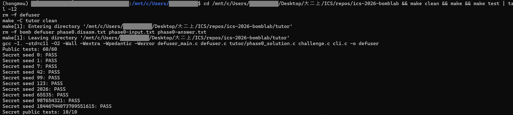
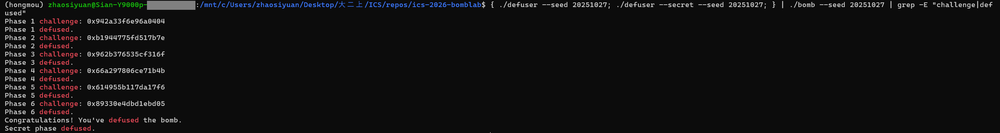
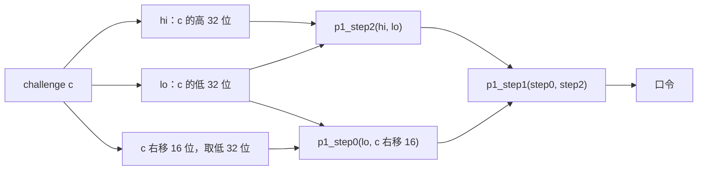
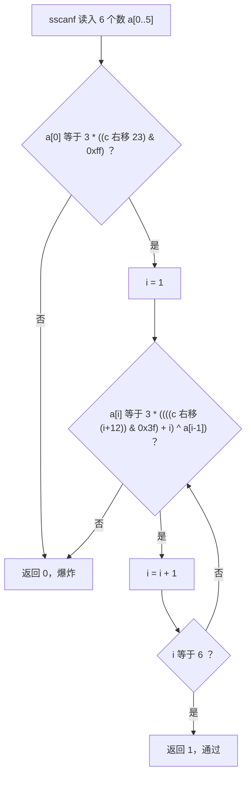
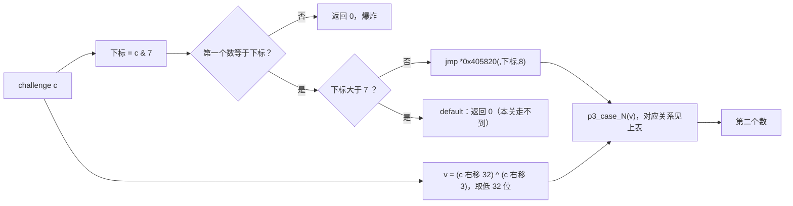
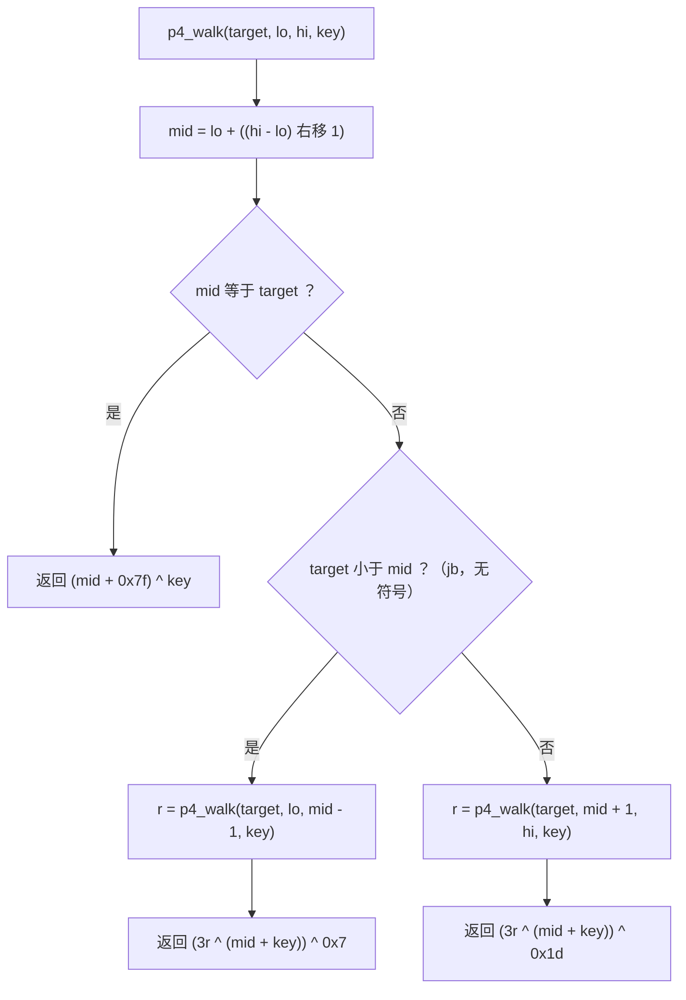
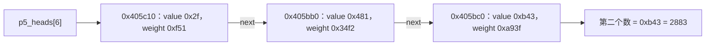
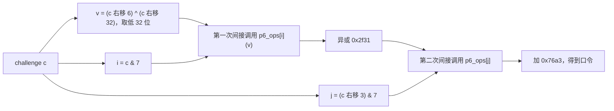
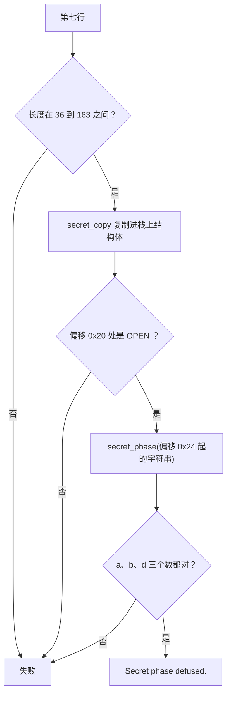

# Lab2: BombLab 实验报告

| 项目        | 内容                                        |
| ----------- | ------------------------------------------- |
| GitHub 仓库 | https://github.com/LeoSian/ics-2026-bomblab |

---

## 一、环境与测试结果

### 1.1 环境

| 项      | 版本                                    |
| ------- | --------------------------------------- |
| 系统    | Windows 11 + WSL 2 / Ubuntu 22.04.5 LTS |
| 架构    | x86_64                                  |
| GCC     | 14.3.0                                  |
| GDB     | 12.1                                    |
| objdump | 2.38                                    |
| Make    | 4.3                                     |
| Python  | 3.12.13                                 |

### 1.2 公开测试

```bash
make clean && make && make test | tail -12
```



六关公开测试 60/60，Honor 公开测试 10/10。

### 1.3 公开列表以外的 seed

公开 seed 是 `tests/public.json` 里的 10 个。另选 seed 20251027，一次跑完六关和 Honor：

```bash
{ ./defuser --seed 20251027; ./defuser --secret --seed 20251027; } | ./bomb --seed 20251027 | grep -E "challenge|defused"
```

输出接到管道时炸弹不打印剧情，`grep` 去掉的是每关的 `Input` 提示行，只留下 challenge 和结果。



这次生成的 7 行口令：

```text
3790663410
750 2214 6627 19794 59349 178152
7 4074669621
2560395152
1767913273 2883
4054042131
AAAAAAAAAAAAAAAAAAAAAAAAAAAAAAAAOPEN 3 2324444652 1440031403
```

六关都输出 `Phase N defused.`，最后输出 `Secret phase defused.`。下面各关的数值例子都取自这次运行：在 GDB 里停在每关的比较指令上，读出程序算出的期望值，和上面的口令逐个相同。

另外用脚本做了更多测试（脚本不在仓库里）：每关用 `--phase N --challenge X` 测了 1141 个 challenge，包括低 7 位的全部 128 种取值（各关选分支只用到 c 的低 7 位，这 128 个值覆盖了第 3、5、6 关的每个分支和第 4 关的每条查找路径）、0 和 2⁶⁴−1 等 13 个边界值、1000 个随机值；Honor 测了 309 个随机 seed。全部通过。

---

## 二、各关分析

### 2.0 共同结构

六关的结构相似。以第 1 关为例：

```text
mov  %rsi,%r12          # challenge 存进 r12
mov  $0x1,%esi
mov  %rdi,%rbx          # 口令字符串存进 rbx
call valid_u32_fields   # 检查口令是不是恰好 N 个无符号整数（N 在 esi）
...
mov  $0x403189,%esi     # 格式串
call 4011e0             # sscanf
...
cmp  %eax,-0x14(%rbp)   # 算出的值和输入比较
sete %al                # 相等返回 1，main 收到 0 就引爆
```

各关的不同之处：

- 第 2 关把 challenge 存在 `r13`、口令字符串存在 `r12`；第 0 个数在循环前比较，第 1–5 个数在循环里比较，都用 `cmp` 加 `jne`，没有 `sete`。
- 格式串地址：第 1、4、6 关是 `0x403189`（`"%u"`），第 3、5 关是 `0x403186`（`"%u %u"`），第 2 关是 `0x40317a`（6 个 `%u`）。
- 输入存放的栈位置和比较的写法，各关见下面各节。

`objdump` 把这条调用显示成 `call 4011e0 <_init+0x1e0>`，看不出函数名。`0x4011e0` 是 PLT 里的一小段跳板，在 GDB 里用 `x/3i 0x4011e0` 能看到它执行 `jmp *0x6e66(%rip)`，即取出 GOT 表项 `__isoc99_sscanf@got.plt` 里存的地址再跳过去，所以调用的是 `sscanf`。格式串用 `x/s 地址` 查看。

所以每关先从 `valid_u32_fields` 的参数和格式串确定口令有几个数，再从最后的比较倒推期望值是怎么由 challenge（下文记作 `c`）算出来的。`c` 是 64 位的，各关先对它做 64 位右移，再取低 32 位，之后的运算都是 32 位、按模 2³² 回绕，所以 C 代码里先移位、再转成 `uint32_t` 计算。

各关反复出现的关键指令：

| 指令                                                     | 含义                                                      | 出现在                                                        |
| -------------------------------------------------------- | --------------------------------------------------------- | ------------------------------------------------------------- |
| `lea (%rdi,%rdi,2),%eax`、`lea 0x6fcd(%rdi,%rdi,4),%eax` | 只做地址形式的算术，不访问内存：`3*rdi`、`5*rdi + 0x6fcd` | 各关                                                          |
| `shr $n,%rax`、`and $mask,%eax`、`movzbl %al,%eax`       | 逻辑右移；取低若干位；取低 8 位                           | 各关从 `c` 中取位段                                           |
| `mov %edi,%esi` 等写 32 位寄存器的指令                   | 只取低 32 位，并把 64 位寄存器的高 32 位清零              | 各关                                                          |
| `cmp` 加 `sete %al` / `jne`                              | 比较；相等时返回值 `al` 为 1 / 不相等就跳到失败           | 各关的检查                                                    |
| `ja`、`jb`、`jbe`                                        | 无符号比较后的跳转                                        | 第 3 关（下标越界）、第 4 关（往左或往右）、Honor（长度检查） |
| `mov -0x40(%rbp,%rdx,4),%esi`                            | 基址 + 下标 × 4，即数组元素 `a[rdx]`                      | 第 2 关                                                       |
| `jmp *0x405820(,%rax,8)`                                 | 从表里取出地址再跳过去（跳转表）                          | 第 3 关                                                       |
| `push %rbx` … `mov -0x8(%rbp),%rbx`                      | 被调用者保管寄存器的保存和恢复，递归时每层各有一份        | 第 4 关；第 6 关用 `rbx` 在第一次间接调用期间保住 `c & 0x38` |
| `mov (%rdx),%rdx`、`mov 0x8(%rdx),%esi`                  | 按偏移读结构体字段，沿 `next` 指针走链表                  | 第 5 关                                                       |
| `call *0x405e00(,%rax,8)`                                | 从表里取出函数地址再调用（函数指针）                      | 第 6 关                                                       |
| `rol $0x3,%eax`、`ror $0x2,%eax`                         | 循环左移、循环右移                                        | 第 6 关                                                       |
| `rep stos`                                               | 把一段内存清零，相当于 `memset`                           | Honor                                                         |
| `cmpl $0x4e45504f,-0xb0(%rbp)`                           | 比较 4 个字节，按小端序就是字符串 `"OPEN"`                | Honor                                                         |

### 2.1 第 1 关：函数调用

口令 1 个数（`"%u"`）。期望值是 `p1_compute(c)` 的返回值：

```text
mov %rdi,%rax ; mov %rdi,%rdx ; mov %edi,%esi    # esi = c 的低 32 位
shr $0x20,%rax ; mov %edi,%r8d ; shr $0x10,%rdx  # rax = c>>32，r8d = 低 32 位，rdx = c>>16
mov %eax,%edi
call p1_step2                                    # p1_step2(hi, lo)
mov %rdx,%rsi ; mov %r8d,%edi ; mov %eax,%ecx
call p1_step0                                    # p1_step0(lo, c>>16)
mov %ecx,%esi ; mov %eax,%edi
call p1_step1                                    # p1_step1(step0, step2)
```

`p1_step2` 只改 `eax` 和 `esi`，所以 `rdx`、`r8d` 在第二次调用时还是调用前算好的值。按调用约定，`rdx`、`r8` 是调用者保管寄存器，一般不能假定调用后不变；这里是编译器知道被调函数的实现才这样用。第 4 关的 `ecx`、Honor 的 `esi` 也是这样。三个小函数：

- `p1_step2(a, b)`：`lea (%rdi,%rdi,2)` 得 `3a`，再和 `b + 0xf7d1` 异或
- `p1_step0(a, b)`：`(b ^ 0x5c70) + 4a`，`xor` 是 32 位运算，只用到 `c>>16` 的低 32 位
- `p1_step1(a, b)`：`(3a + b) ^ 0x4147`

计算关系：

```text
step2 = 3*hi ^ (lo + 0xf7d1)
step0 = ((uint32)(c >> 16) ^ 0x5c70) + 4*lo
口令  = (3*step0 + step2) ^ 0x4147
```

数据流图：



例子：c = `0x942a33f6e96a0404`，step2 = 1427398711，step0 = 3651061034，口令 3790663410。GDB 停在 `0x4020e0`（比较指令）时 `eax` 是 3790663410。

### 2.2 第 2 关：数组和循环

口令 6 个数。`sscanf` 的 6 个地址是 `-0x40` 到 `-0x2c`，每个差 4 字节（前 4 个放在 `rdx, rcx, r8, r9`，后 2 个用 `push` 压栈），是一个数组 `a[6]`。

```text
shr $0x17,%rax ; movzbl %al,%eax ; lea (%rax,%rax,2),%eax   # a[0] = 3 * ((c >> 23) & 0xff)
cmp %eax,%esi
                                                    # 循环，rdx = 1..5
lea 0xc(%rdx),%ecx ; mov %r13,%rax ; shr %cl,%rax   # c >> (i + 12)
and $0x3f,%eax ; add %edx,%eax ; xor %esi,%eax      # (... & 0x3f) + i，再异或上一个数
mov -0x40(%rbp,%rdx,4),%esi                         # esi = a[i]，下一轮的“上一个数”
lea (%rax,%rax,2),%eax ; cmp %eax,%esi              # a[i] 必须等于 3 倍
add $0x1,%rdx ; cmp $0x6,%rdx ; jne
```

计算关系：

```text
a[0] = 3 * ((c >> 23) & 0xff)
a[i] = 3 * ((((c >> (i + 12)) & 0x3f) + i) ^ a[i-1])，i = 1..5
```

控制流图：



例子：c = `0xb1944775fd517b7e`，`(c >> 23) & 0xff` = 250，a[0] = 750；i = 1 时 `(c >> 13) & 0x3f` = 11，`(11 + 1) ^ 750` = 738，a[1] = 2214；依次得到 6627、19794、59349、178152。GDB 在两处比较指令（`0x40216a`、`0x40218a`）看到的 6 个期望值相同。

### 2.3 第 3 关：switch 和跳转表

口令 2 个数。第一个数要等于 `c & 7`（`and $0x7,%edi; cmp %edi,-0x18(%rbp)`）。第二个数是 `p3_dispatch(c & 7, v)` 的返回值，其中 `v = (uint32)(c >> 32) ^ (uint32)(c >> 3)`。

```text
p3_dispatch:
mov %edi,%eax ; mov %esi,%edi       # eax = 下标，edi = v
cmp $0x7,%eax ; ja 4022a5           # 下标 > 7 返回 0（default）；本关下标是 c & 7，走不到
notrack jmp *0x405820(,%rax,8)      # 按跳转表跳转
```

用 `x/8gx 0x405820` 查看跳转表，表里每个地址处是一条 `jmp p3_case_N`。下标和分支的对应关系是打乱的：

| 下标 | 分支      | 计算                      |
| ---- | --------- | ------------------------- |
| 0    | p3_case_3 | `(2v) ^ 0x90eb`           |
| 1    | p3_case_2 | `5v + 0x2779a`            |
| 2    | p3_case_6 | `(4v) ^ 0xc298`           |
| 3    | p3_case_4 | `3v + 0xbe13`             |
| 4    | p3_case_7 | `(v ^ 0x7122) + (v >> 2)` |
| 5    | p3_case_5 | `5v + 0x3f25f`            |
| 6    | p3_case_1 | `(v ^ 0x1785) + (v >> 2)` |
| 7    | p3_case_0 | `5v + 0x6fcd`             |

各分支多用 `lea`，例如 `lea 0x6fcd(%rdi,%rdi,4),%eax` 就是 `5v + 0x6fcd`。代码里用 `switch` 写。

控制流图：



例子：c = `0x962b376535cf316f`，下标 7，v = 814928200，跳到 `p3_case_0`，第二个数 `5v + 0x6fcd` = 4074669621。GDB 停在 `0x40225d`（间接跳转）时看到下标 7、表项 `0x402270`。

### 2.4 第 4 关：递归

口令 1 个数，等于 `p4_walk(c & 0x7f, 0, 127, key)`，`key = (uint32)(c >> 7) ^ (uint32)(c >> 32)`。

```text
p4_walk(target=edi, lo=esi, hi=edx, key=ecx):
mov %edi,%eax                                              # eax = target，edi 下面用来放 mid
mov %edx,%edi ; sub %esi,%edi ; shr %edi ; add %esi,%edi   # mid = lo + ((hi - lo) >> 1)
cmp %eax,%edi ; je 402390                                  # mid == target：跳到 402390
push %rbp ; mov %rsp,%rbp ; push %rbx                      # 要继续递归，才建栈帧、保存调用者的 rbx
lea (%rdi,%rcx,1),%ebx                                     # ebx = mid + key
cmp %edi,%eax ; jb 402370                                  # target < mid（无符号）往左
  lea 0x1(%rdi),%esi ; mov %eax,%edi ; call p4_walk        # 往右：r = p4_walk(target, mid+1, hi, key)
  lea (%rax,%rax,2),%eax ; xor %ebx,%eax                   # 3r ^ (mid + key)
  mov -0x8(%rbp),%rbx ; leave ; xor $0x1d,%eax ; ret       # 恢复 rbx，再异或 0x1d
402370:
  lea -0x1(%rdi),%edx ; mov %eax,%edi ; call p4_walk       # 往左：r = p4_walk(target, lo, mid-1, key)
  lea (%rax,%rax,2),%eax ; xor %ebx,%eax
  mov -0x8(%rbp),%rbx ; leave ; xor $0x7,%eax ; ret        # 恢复 rbx，再异或 0x7
402390:
  lea 0x7f(%rdi),%eax ; xor %ecx,%eax ; ret                # 找到：返回 (mid + 0x7f) ^ key
```

这是在 0..127 里二分查找 target。找到时返回 `(mid + 0x7f) ^ key`；每往回返回一层，把下层结果乘 3、异或本层的 `mid + key`，往左走的层再异或 7，往右走的层再异或 0x1d。`ebx` 是被调用者保管的寄存器：没找到 target 的层在 `je` 之后 `push %rbx`，返回前用 `mov -0x8(%rbp),%rbx` 恢复，所以每层用的都是自己的 `mid + key`；找到 target 的最底层不用 `ebx`，也就不保存它。`key` 在 `ecx` 里，各层都不改它。

控制流图：



例子：c = `0x66a297806ce71b4b`，target = 75，key = 1719359926。查找路径 63 → 95 → 79 → 71 → 75，最底层返回 1719359868，逐层返回 1426675092、2573687486、2857191976、2560395152。GDB 停在 `0x402390` 时用 `bt` 看到 5 层 `p4_walk`，返回地址依次对应右、左、左、右，和路径一致。

### 2.5 第 5 关：结构体和链表

口令 2 个数：第一个等于 `p5_traverse(c, &out)` 的返回值，第二个等于 `out`。

```text
mov %rdi,%rax ; mov %rdi,%rcx ; mov %rsi,%r8                 # r8 = &out
and $0x7,%eax ; shr $0x3,%rcx                                # rcx = c >> 3
mov 0x405b60(,%rax,8),%rdx                                   # node = p5_heads[c & 7]
mov %rdi,%rax ; shr $0x20,%rdi ; shr $0x6,%rax ; xor %edi,%eax
mov 0x8(%rdx),%esi                                           # node 偏移 8：value
mov %ecx,%edi                                                # edi = (c >> 3) 的低 32 位
xor $0x488a,%eax                                             # acc 初值 = ((c >> 6) ^ (c >> 32)) ^ 0x488a（32 位）
lea (%rax,%rax,2),%eax ; add 0xc(%rdx),%eax                  # acc = 3*acc + 偏移 0xc 的 weight
mov %esi,(%r8) ; xor %esi,%eax                               # out = value；acc ^= value
and $0x3,%edi ; je 402480                                    # 步数 = (c >> 3) & 3，为 0 直接返回
mov $0x1,%ecx
402468:
mov (%rdx),%rdx                                              # node = 偏移 0 的 next
lea (%rax,%rax,2),%eax ; add $0x1,%ecx
mov 0x8(%rdx),%esi ; add 0xc(%rdx),%eax ; xor %esi,%eax ; mov %esi,(%r8)
cmp %ecx,%edi ; jae 402468                                   # 步数 >= ecx 就继续，一共走“步数”次
```

由三个偏移推出结点是 16 字节的结构体：

```c
struct p5_node { const struct p5_node *next; uint32_t value; uint32_t weight; };
```

用 `x/8gx 0x405b60` 读出 8 个表头，用 `x/24gx 0x405ba0` 读出 12 个结点（小端序，第二个 8 字节的低 4 字节是 value，高 4 字节是 weight），在 `defuser.c` 里照抄成静态数组。8 个起点往后走 3 步都不会遇到空指针。

计算关系：

```text
node = p5_heads[c & 7]
acc  = ((uint32)(c >> 6) ^ (uint32)(c >> 32)) ^ 0x488a
acc  = (3*acc + node->weight) ^ node->value
重复 (c >> 3) & 3 次：node = node->next；acc = (3*acc + node->weight) ^ node->value
口令 = 两个数：acc 和最后那个结点的 value
```

下面是例子中实际走过的链表（数据结构图）：



例子：c = `0x614955b117da17f6`，起点 `p5_heads[6]` = `0x405c10`，走 2 步，经过 `0x405bb0` 到 `0x405bc0`（value 0xb43 = 2883），口令 `1767913273 2883`。GDB 在循环里看到的结点地址和两个期望值都相同。

### 2.6 第 6 关：函数指针表

口令 1 个数，等于 `p6_dispatch(c)` 的返回值。下面是 `p6_dispatch` 的汇编：

```text
shr $0x6,%rdi ; shr $0x20,%rax ; xor %eax,%edi   # v = (uint32)(c >> 6) ^ (uint32)(c >> 32)
and $0x38,%ebx                                   # ebx = c & 0x38，即 8 * ((c >> 3) & 7)
and $0x7,%eax
call *0x405e00(,%rax,8)                          # r = p6_ops[c & 7](v)
xor $0x2f31,%eax ; mov %eax,%edi
call *0x405e00(%rbx)                             # r = p6_ops[(c >> 3) & 7](r ^ 0x2f31)
add $0x76a3,%eax                                 # 口令 = r + 0x76a3
```

用 `x/8gx 0x405e00` 读出函数指针表：

| 下标 | 0       | 1       | 2       | 3       | 4       | 5       | 6       | 7       |
| ---- | ------- | ------- | ------- | ------- | ------- | ------- | ------- | ------- |
| 函数 | p6_op_1 | p6_op_0 | p6_op_5 | p6_op_5 | p6_op_0 | p6_op_4 | p6_op_3 | p6_op_2 |

6 个函数：

- `p6_op_0`：`(v ^ 0x81a5) + 2v`
- `p6_op_1`：`(32v + 0x8dc9) ^ 7v`（`shl $0x5`；`lea 0x0(,%rdi,8)` 减 v 得 7v）
- `p6_op_2`：`(v + 0xc26) ^ (v >> 1)`
- `p6_op_3`：循环左移 3 位（`rol`）后 `^ 0x5beb`
- `p6_op_4`：循环右移 2 位（`ror`）
- `p6_op_5`：`(v ^ (v >> 3)) + 0x3459`

C 没有循环移位运算符，用 `(v << 3) | (v >> 29)` 这样的写法。代码里也建了一个同样顺序的函数指针数组。

数据流图：



例子：c = `0x89330e4dbd1ebd05`，`c & 7` = 5 → `p6_op_4`，`(c >> 3) & 7` = 0 → `p6_op_1`；v = 3217519801，第一次调用得 1878121774，异或后 1878127135，第二次调用得 4054011760，加 0x76a3 得 4054042131。GDB 在两条 `call *` 处用 `info symbol` 确认目标是 `p6_op_4` 和 `p6_op_1`。

### 2.7 Honor

六关通过后，`main` 再读一行，调用 `secret_gate(这一行, challenge, context)`。`context` 由前六行口令算出（`transcript_context`），驱动已经算好传给 `solve_secret`。

```text
secret_gate:
lea -0xd0(%rbp),%r12 ; rep stos ; movl $0x0,(%rdi)   # 栈上结构体清零：0x14 个 8 字节加 4 字节，共 164 字节
call 401190 ; sub $0x24,%rax ; cmp $0x7f,%rax ; jbe   # 401190 是 strlen 的 PLT 跳板；长度在 36 到 163 之间
call secret_copy                          # 把整行逐字节复制进结构体，不检查长度
cmpl $0x4e45504f,-0xb0(%rbp)              # 结构体偏移 0x20 处必须是 0x4e45504f
lea -0xac(%rbp),%rdi ; call secret_phase  # 偏移 0x24 起的字符串交给 secret_phase
```

栈上结构体（起点 `rbp-0xd0`）和第七行的对应关系：

| 结构体偏移   | 0x00–0x1f | 0x20–0x23          | 0x24 起                   |
| ------------ | --------- | ------------------ | ------------------------- |
| 第七行的内容 | 32 个 `A` | `OPEN`             | 一个空格和 3 个数 `a b d` |
| 程序怎么检查 | 不检查    | `cmpl $0x4e45504f` | 交给 `secret_phase`       |

控制流图：



`0x4e45504f` 按小端序的字节是 `4f 50 45 4e`，即 `"OPEN"`。`secret_copy` 不管第一个字段多长，所以第七行的前 32 个字符填满第一个字段，第 33 到 36 个字符写进偏移 0x20 的字段，后面的部分在偏移 0x24。这和 `teaching/07_stack_copy.c` 里同一结构体内相邻字段被覆盖的情况相同，整行最长 163 个字符加结尾的 `\0`，不会超出这 164 字节，也不涉及返回地址。

`secret_phase(s, challenge, context)` 要求 3 个数（`"%u %u %u"`）：

```text
                                                        # r12 = challenge，r13 = context
mov %r13d,%ecx ; and $0x3,%ecx ; cmp %ecx,-0x2c(%rbp)   # a = context & 3
mov %r12,%rsi ; imul $0x5f8,%ecx,%r9d ; mov %r13,%r8     # r9d = a * 0x5f8
shr $0x20,%rsi ; shr $0x20,%r8
xor %r12d,%esi                                          # c_fold = challenge 高 32 位 ^ 低 32 位
xor %r13d,%r8d                                          # x_fold = context 高 32 位 ^ 低 32 位
shr $0x10,%r13                                          # 从这里起 r13 = context >> 16
mov %esi,%edi ; xor %r13d,%r9d                          # mask = (a * 0x5f8) ^ (uint32)(context >> 16)
xor %r8d,%edi ; call secret_mix                         # secret_mix(c_fold ^ x_fold)
xor %r9d,%eax ; cmp %eax,-0x28(%rbp)                    # b = secret_mix(...) ^ mask
shr $0x3,%esi ; lea 0xe3c8(%r8,%rcx,1),%edx ; add %esi,%edx
xor %edx,%eax ; cmp -0x24(%rbp),%eax                    # d = b ^ (x_fold + a + 0xe3c8 + (c_fold >> 3))
```

`secret_mix` 只改 `eax` 和 `edi`，所以调用回来后 `esi`（c_fold）、`r8d`（x_fold）、`ecx`（a）还是调用前的值。

其中 `secret_mix(m) = ((m >> 3) ^ 0xe3c8) + (m ^ 0x5f8)`。第七行写成 32 个 `A`，接 `OPEN`，再接 ` a b d`。`OPEN` 后面的空格不影响，`valid_u32_fields` 和 `%u` 都会跳过开头的空白。

例子（seed 20251027）：Honor 的 challenge 是 `0xd9c9da0114a4df67`，context 是 `0x4222835387881183`，a = 3，b = 2324444652，d = 1440031403。GDB 停在 `0x40279b`（复制之后）时看到偏移 0x20 处是 `0x4e45504f`，三处比较的期望值和这三个数相同。

---

## 三、参考资料与辅助工具

### 3.1 参考资料

- 实验文档：https://ics-26fall-fdu.github.io/labs/lab2-bomb-lab/ ，主要用到“实验引导”里的寄存器约定和 GDB 用法
- 模板仓库的 `README.md`、`tutor/README.md`，以及 `teaching/07_stack_copy.c`（Honor 的相邻字段覆盖）
- 《深入理解计算机系统》第 3 版第 3 章。

### 3.2 辅助工具及用途

本次实验使用了 Claude Code（模型 Claude Opus 5.5），在 WSL 中运行。它做了这些事：

- 用 `objdump` 导出各关汇编，用 GDB 读出跳转表、链表、函数指针表等数据，分析出各关的计算关系；
- 编写 `defuser.c` 中六关和 Honor 的全部求解函数；
- 验证：用 GDB 在每关的比较指令处核对期望值，写脚本测试随机 challenge 和 seed；
- 写本报告的初稿，并另开一个检查助手，对照实验文档独立检查报告和仓库；
- 给两张截图里的用户名、主机名和路径中的个人信息打码。

所以本报告第二部分的分析和 `defuser.c` 的代码是 AI 生成的，不是我独立完成的分析。我自己做的是：在 GitHub 上用模板创建仓库、确认学号、在自己的终端里运行命令并截图、对照实验文档逐项检查提交要求、推送代码和 `final` 标签。
